<p align="center">
  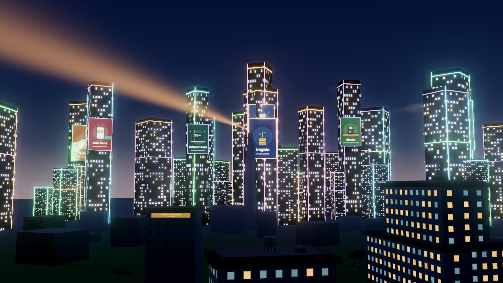
</p>

<h1 align="center">Builders World</h1>

<p align="center">
  <b>A living, browser-based world for developers and designers, set in real African cities, where your real work is your currency.</b>
</p>

<p align="center">
  <a href="https://buildersworld.vercel.app/"><b>Play it</b></a> ·
  <a href="https://buildersworld.vercel.app/?world=1">Straight into the world</a> ·
  <a href="#a-tour-of-the-world">Tour</a> ·
  <a href="#run-it-locally">Run it locally</a> ·
  <a href="CONTRIBUTING.md">Contribute</a>
</p>

<p align="center">
  <a href="LICENSE"></a>
  <a href="apps/game/public/city/LICENSE.md"></a>
  <a href="https://github.com/builders-world/builders-world/actions/workflows/game.yml"></a>
  <a href="https://github.com/builders-world/builders-world/actions/workflows/backend.yml"></a>
</p>

Every commit you push on GitHub becomes **Efforts**, the money you spend in the world. You arrive, get a home, and live
a builder's life: work from hubs, cafés and studios, ride across the city, fly to another one, play padel after work,
and meet the other builders who are online at the same time.

The streets are real. Lagos, Nairobi, Accra, Abuja, Port Harcourt and Uyo are rebuilt from OpenStreetMap at their real
size, on their real street grid, with the real time of day and the weather that's happening there right now. It all
runs in the browser, with no download and no game engine: three.js, Vite and a small Rust server.

## Contents

| The world | Playing | Building | Project |
|:--|:--|:--|:--|
| [Status](#status) | [What you need to play](#what-you-need-to-play) | [Run it locally](#run-it-locally) | [Contributing](#contributing) |
| [A tour of the world](#a-tour-of-the-world) | [Controls](#controls) | [Run the tests](#run-the-tests) | [Still to come](#still-to-come) |
| [The cities](#the-cities) | [Troubleshooting](#troubleshooting) | [How it's built](#how-its-built) | [Team](#team) |
| [What you can do](#what-you-can-do) | [Privacy](#privacy) | [What's in this repository](#whats-in-this-repository) | [Licences and credits](#licences-and-credits) |

## Status

In early development and changing fast, with no versioned releases yet. The
[live game](https://buildersworld.vercel.app/) is built from `main` and can be a few days behind it. Sign-in, other
players, chat, street bins and your commit count come from the server. Your Efforts balance is still kept in your
browser (see [Still to come](#still-to-come)). Signed out, or with no server, you play alone with a demo balance.

## A tour of the world

<table>
  <tr>
    <td width="50%">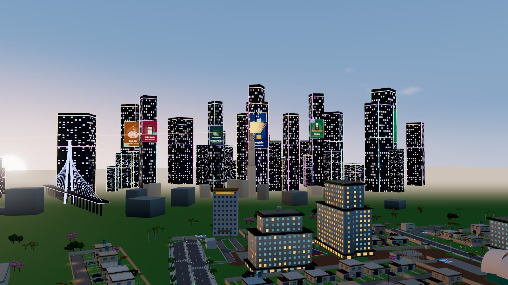</td>
    <td width="50%">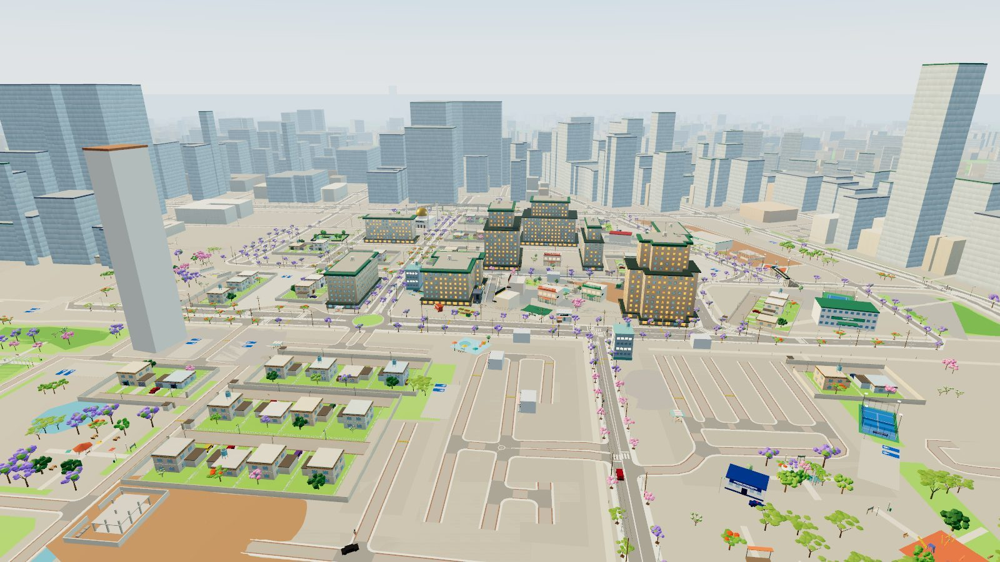</td>
  </tr>
  <tr>
    <td><b>Lagos at golden hour.</b> Victoria Island, the Lekki-Ikoyi Link Bridge and the skyline. The sun sets when it sets in Lagos.</td>
    <td><b>Nairobi from the air.</b> Each city is streamed round you to the horizon, every building from OpenStreetMap.</td>
  </tr>
  <tr>
    <td>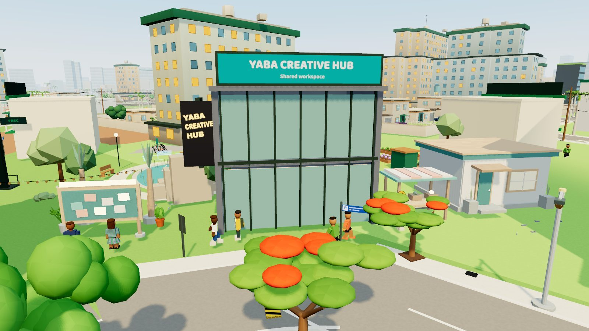</td>
    <td>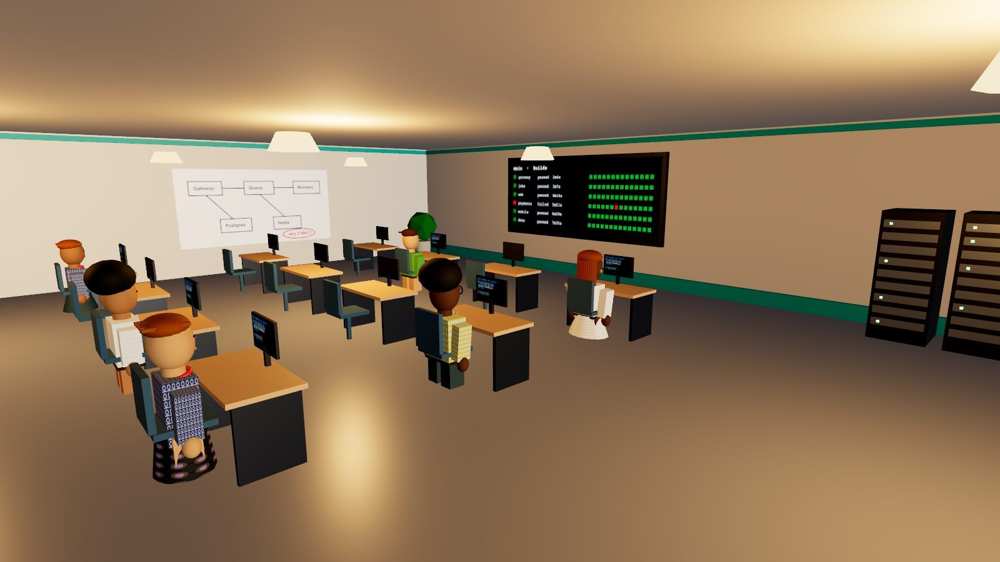</td>
  </tr>
  <tr>
    <td><b>Yaba, where it started.</b> The Creative Hub, the community board and residents going about their day.</td>
    <td><b>Work from a hub.</b> Find a free desk, ask for the Wi-Fi password, open your laptop.</td>
  </tr>
  <tr>
    <td>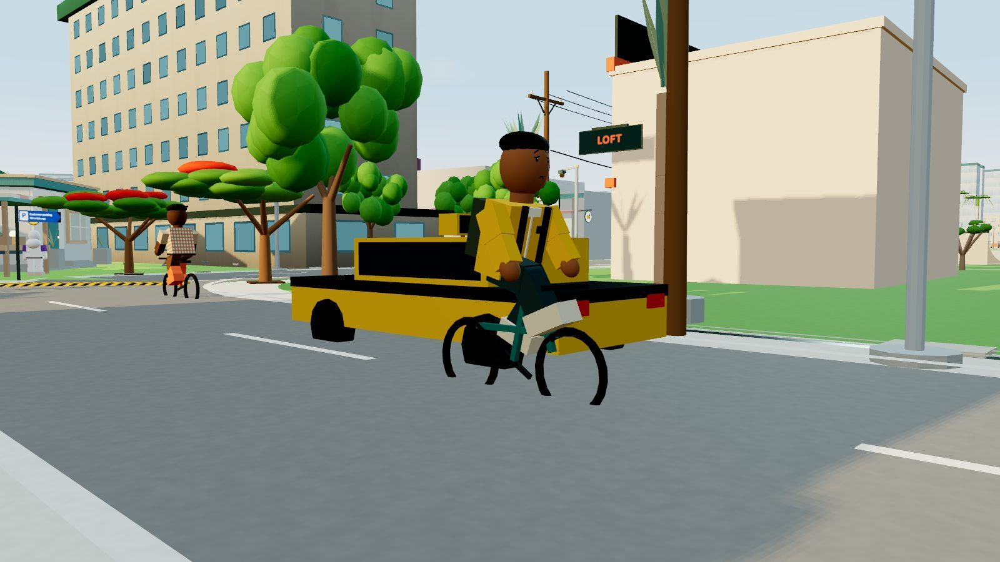</td>
    <td>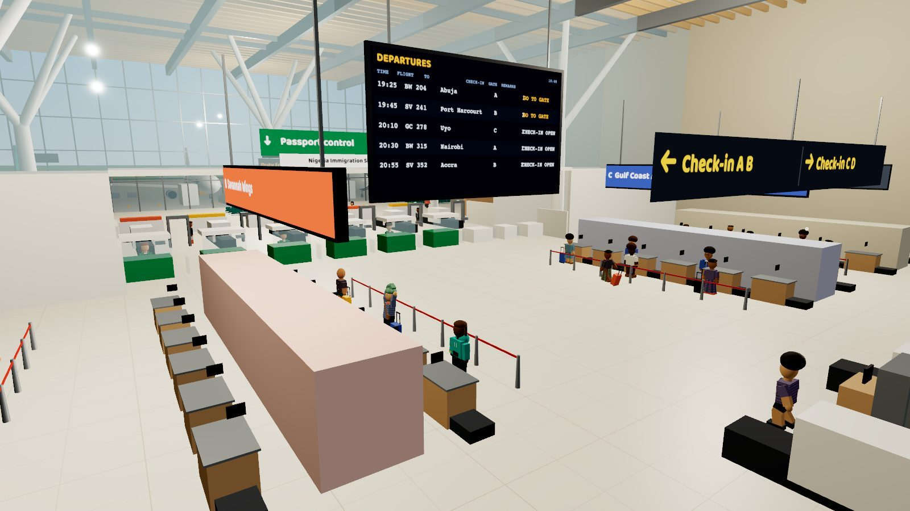</td>
  </tr>
  <tr>
    <td><b>Get around.</b> Walk, cycle, skate, or hire a danfo, keke or taxi. Driving yourself needs a licence.</td>
    <td><b>Fly to another city.</b> Check in, go through security and passport control, board, land, clear customs.</td>
  </tr>
  <tr>
    <td>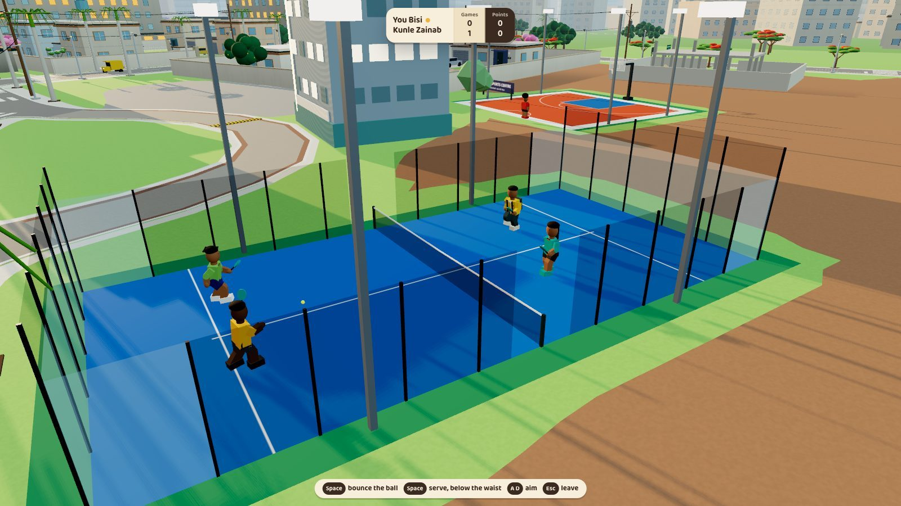</td>
    <td>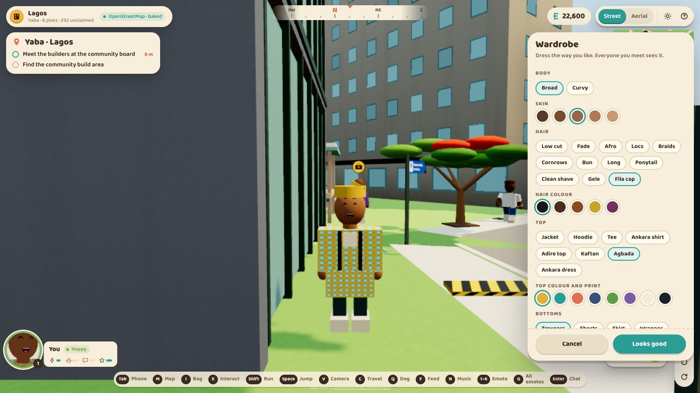</td>
  </tr>
  <tr>
    <td><b>Play by the real rules.</b> Padel, tennis, table tennis, basketball, swimming, and chess against regulars or anyone online.</td>
    <td><b>Dress your way.</b> Ankara, Adire, kaftan and agbada, gele and fila, and ten hairstyles.</td>
  </tr>
  <tr>
    <td>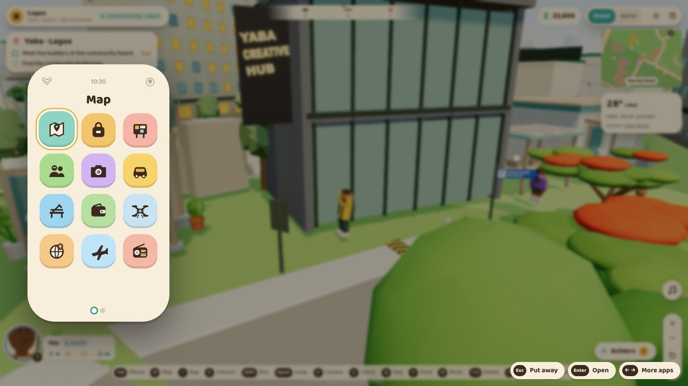</td>
    <td>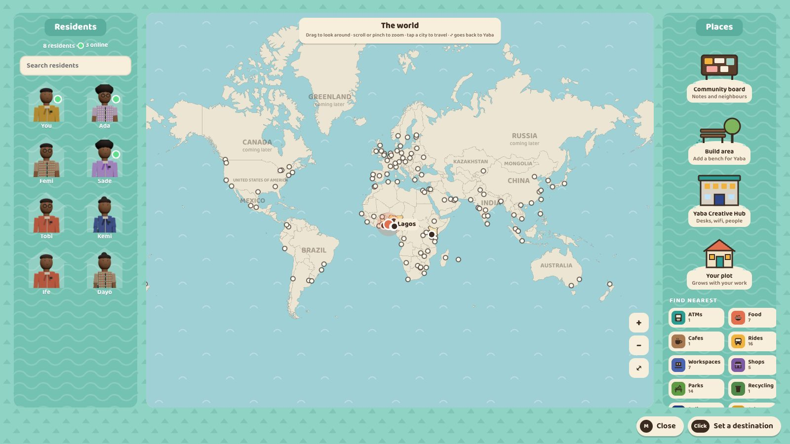</td>
  </tr>
  <tr>
    <td><b>A phone with real apps.</b> Map, Ride, Travel, Wallet, Radio, Weather, Pets, Sports. It needs Wi-Fi.</td>
    <td><b>The world map.</b> 135 tech cities in 84 countries: six live today, the rest coming.</td>
  </tr>
</table>

<p align="center">
  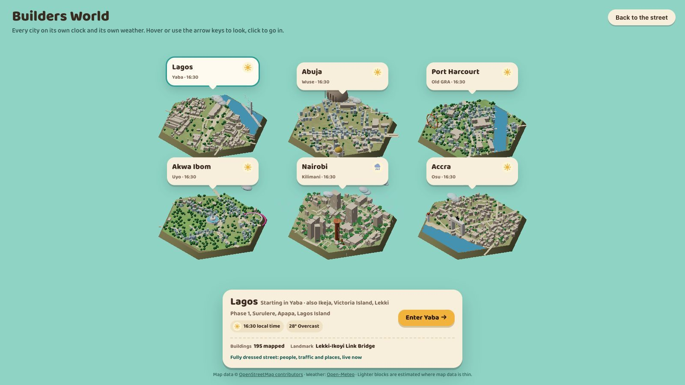
  &nbsp;
  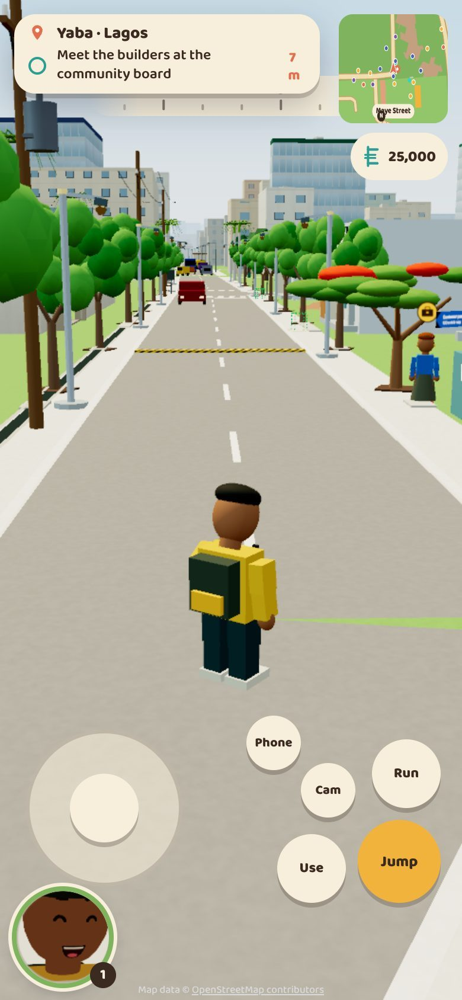
</p>
<p align="center"><sub>Pick a city, each on its own clock and weather. It plays on phones too, with touch controls.</sub></p>

<sub>Screenshots from `main` on 22 October 2026, on a desktop browser. The live game can be a few days behind `main`.</sub>

## The cities

Six cities are live, each with areas built in full and the whole city streamed round them:

| City | Areas | The open world covers |
|---|---|---|
| **Lagos** | Yaba, Ikeja, Victoria Island, Lekki Phase 1, Surulere, Apapa, Lagos Island | Ikeja down to Lagos Island and Lekki Phase 1, about 18 by 23 km |
| **Nairobi** | Kilimani, City Centre, Westlands | Central Nairobi, Westlands and Kilimani, about 9 by 7 km |
| **Accra** | Osu, Accra Central, Airport City | Osu, Accra Central and Airport City, down to the sea |
| **Abuja** | Wuse, Central Business District, Jabi | Wuse, the CBD and Jabi |
| **Port Harcourt** | Old GRA, Rumuola, Trans-Amadi | Old GRA, Rumuola and Trans-Amadi |
| **Akwa Ibom** | Uyo, Ring Road Uyo, Eket, Ikot Ekpene | Uyo and Ring Road |

Each city has its own landmarks, side of the road (Nairobi keeps left), vehicles (danfos, matatus, trotros, kekes),
street food, real FM radio stations, signs and accents. A Nairobi resident speaks Swahili, English or Sheng and is
called Wanjiku or Otieno; that comes from each city's knowledge base in [`cities/`](cities).

Another 129 cities are on the world map as "coming later". Adding one is a good first contribution:
[cities/README.md](cities/README.md#adding-a-city).

## What you can do

**Live a builder's life**
- Start in your own home: seven rooms with a workspace, a lab and a studio. Sit, sleep, cook, shower, watch TV.
- Work from hubs, a co-working loft, a design studio and cafés. Wi-Fi has passwords, found on notice boards, menus and
  your membership cards. Some places are members only.
- Earn Efforts from your GitHub commits and spend them on rides, food, gadgets, passes, fees and travel.
- Carry a bag with gadgets, badges, and a card holder for your passes, passport and driver's licence.

**Live in the city**
- Residents have names, jobs, families, homes and moods, and greet you in English or Pidgin.
- Traffic keeps to its lanes and the speed limit and gives way at crossings, with LASTMA, FRSC and NTSA officers on the
  roads.
- Order suya, roasted corn or a plate from a food truck face to face, and watch it being made.
- Feed the pigeons, make friends with a dog, or adopt your own and walk around as it.
- Live time of day and weather: morning mist, rain, wet streets that dry, streetlights at dusk.

**Get around**
- On foot (click to walk, with a GPS trail), on rented bikes, or on your own bicycle, skateboard, skates, hoverboard or
  e-scooter.
- By hired danfo, keke or taxi, as a passenger, or as the driver once you've passed the eye and theory tests.
- By taxi across the city to its other areas and landmarks, or by plane to another city. Flying abroad needs a passport
  from the Immigration Centre.

**Together**
- Sign in with GitHub and see the other builders who are online, on the street and on the map. Chat, emote, and look at
  each other's profiles (only what each person chooses to share).
- Pick up litter, fund street bins together, build benches in the community build area, pin notes on the board.
- Play sport by the real rules, and chess against anyone online.

The full feature list is in the [game's README](apps/game/README.md#whats-in-it-today).

## What you need to play

- **A browser with WebGL 2.** The game draws with three.js, which no longer supports WebGL 1. There's nothing to
  install. The automated browser tests run in Chromium, at a desktop size and a phone size.
- **A keyboard and mouse, a touch screen or a controller.** Touch controls come on by themselves on touch screens.
  PlayStation and Xbox controllers, and others with the standard layout, work on desktop and on phones.
- **No minimum hardware.** The targets are 60 frames a second on a mid-range laptop and 30 on a mid-range Android
  phone. Graphics start on Auto, which reads your graphics chip, memory and cores and picks a tier. On Auto, phones
  start on Low, or Medium with 6 GB of memory and 8 cores or more. If the frame rate can't hold, the game draws less
  far detail and lowers the resolution, and on Auto it then drops a tier.

## Controls

| Key | Does | Key | Does |
|---|---|---|---|
| W A S D / arrows | Walk (or click the street to walk there) | Tab | Phone |
| Shift | Run | M | Map |
| Space | Jump | I | Bag |
| E | Interact, enter, order, talk | V | Camera view |
| C | Cinematic travel along your route | B | Aerial view |
| 1 to 6, G | Emotes, all emotes | Enter | Chat |
| Q | Play as your dog | Esc | Close, stand up |

It also plays with a PlayStation or Xbox controller, and with touch controls on phones. Every key is in the
[game's README](apps/game/README.md#controls).

## Run it locally

You need Node 20 or newer.

```sh
git clone https://github.com/builders-world/builders-world.git
cd builders-world/apps/game
npm install
npm run dev
```

Open the address it prints for the onboarding, or add `?world=1` to go straight into the world. Without the server
the game plays on its own with a demo balance.

Some useful switches to add to the address:

| Switch | What it does |
|---|---|
| `?city=Nairobi&area=Westlands` | Start in a city and area |
| `?hour=19.5` | Set the time of day |
| `?wx=rain` | Set the weather: `clear`, `cloudy`, `drizzle`, `rain`, `storm`, `fog`, `haze` |
| `?quality=low` | Graphics tier: `low`, `medium`, `high`, `ultra` (Auto adapts to your device) |
| `?hud=0` | Hide the interface |

The rest are in the [game's README](apps/game/README.md#useful-switches). To run the server for sign-in and other
players, see [`services/backend`](services/backend/README.md#quick-start) (Rust, PostgreSQL and Redis).

### Run the tests

The game, from `apps/game`. The browser tests start the dev server themselves.

```sh
npm test                          # unit tests, including a check of every file in cities/
npx playwright install chromium   # once per machine
npm run test:browser              # browser tests, at a desktop size and a phone size
npm run build
```

The server, from `services/backend`. The second line also runs the PostgreSQL and Redis tests, so start both first
(the [quick start](services/backend/README.md#quick-start) shows how):

```sh
cargo test --workspace      # no services needed
DATABASE_URL=postgres://... REDIS_URL=redis://... cargo test --workspace -- --include-ignored
```

The full list of checks for a pull request is in [CONTRIBUTING.md](CONTRIBUTING.md#before-you-open-a-pull-request).

## Troubleshooting

**It's slow or it stutters.** Open the phone (Tab), then Settings, Graphics, and pick a lower Quality, or add
`?quality=low` to the address. "Show frame rate" in the same place puts a counter on screen, so you can see what each
setting costs.

**The 3D doesn't start, or the world stays blank.** The game needs WebGL 2. Turn on hardware acceleration in your
browser's settings, update the browser, or try another one. The onboarding says "3D could not start" when this happens.
Going straight into the world (`?world=1`), the page stays empty and the error is in the browser console.

**No sign-in, no other players, a demo balance.** The game is playing alone. It does this when you're signed out or it
can't reach the server, and it shows no error. Locally, run the [server](services/backend/README.md#quick-start). GitHub
sign-in also needs your own GitHub OAuth app, set up with the variables in
[`.env.example`](services/backend/.env.example). `?offline=1` plays alone on purpose.

**Signed in, but nobody else is there.** You see the builders in the same area as you who have been online in the last
12 seconds.

**On a phone.** If the touch controls are missing or in the way, set Settings, Controls, Touch controls to On or Off. If
it runs slowly, pick Low in Settings, Graphics.

## How it's built

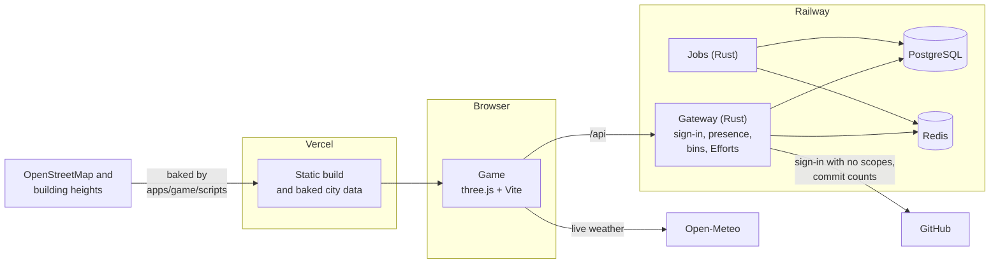

- **The world is baked, not queried live.** Streets, buildings, heights and terrain are baked from open data into JSON
  chunks (`apps/game/public/city/`) that ship with the game. Only the 200 m pieces near you are built, in a worker,
  with detail that scales with distance and with your device.
- **One set of rules, a look per city.** Traffic, zoning, physics and UI work the same everywhere; architecture,
  vehicles, food, radio and language are set per city.
- **The server only knows what it must.** The gateway handles GitHub sign-in (no scopes, so it can't see your code),
  who is online, the street bins and the Efforts count. Everything a browser sends is cleaned before it's stored or
  shown.
- **The [world bible](docs/design/world-bible.md) is the source of truth** for scale, streets, level design, art, game
  logic, UI, writing and performance. The [PRD](docs/product/builders-world-prd.md) decides what the product is; the
  bible decides how it's built.

## Privacy

Signing in is optional. When you sign in with GitHub:

- **The game asks GitHub for no scopes.** It reads your account id, username and name, and nothing else. It can't see
  your code or private repositories. The GitHub token is used once for that and isn't kept.
- **The server stores your account and your profile.** That's your GitHub id, username and name (refreshed each time
  you sign in), and what you choose at arrivals, in the wardrobe and for your public profile, so it follows you to
  other devices. Your session lasts 30 days. The server keeps only a hash of the session token, and signing out ends
  it.
- **Players in the same area see you.** They see your GitHub username and name, your position, look and pet, your
  in-game home address, the last thing you said or emoted, and, if you turn it on, the track you're playing on
  Spotify. The game sends this to the server about once a second. Others stop seeing you 12 seconds after you leave,
  and the server deletes it about a minute later.
- **Your public profile is yours to fill.** Your role and socials show only if you fill them in, and your socials and
  commit count only if you switch them on, in Settings, Public profile. Leave a box empty to keep it private.
- **Funding a street bin is public.** Your GitHub username shows beside the bins you help pay for.
- **Your wallet stays in your browser,** with your settings.

[SECURITY.md](SECURITY.md) has the details and how to report a problem.

## What's in this repository

| Folder | What it is | Checks |
|---|---|---|
| [`apps/game`](apps/game) | The game (three.js + Vite). Deploys to Vercel from `main` | [`game.yml`](.github/workflows/game.yml): unit tests, build, browser tests |
| [`services/backend`](services/backend) | The Rust gateway and jobs. Deploys to Railway | [`backend.yml`](.github/workflows/backend.yml): fmt, clippy, tests, sqlx |
| [`cities`](cities) | One folder per country and city, with each city's knowledge base | checked by the game's tests |
| [`assets`](assets) | Blender sources, the procedural model kit, reference art | |
| [`docs`](docs) | Product, world bible, architecture, decisions and collaboration notes | |

Each check runs only when its folder changes. `packages/`, `database/`, `infra/`, `tests/` and `tools/` are reserved for
the planned architecture; see the [repository layout](docs/architecture/repository-layout.md).

**Project documents**
- [Product requirements (PRD v1.1)](docs/product/builders-world-prd.md), also as [HTML](docs/product/exports/builders-world-prd-v1.1.html) and [PDF](docs/product/exports/builders-world-prd-v1.1.pdf)
- [World bible](docs/design/world-bible.md) and the [immersive onboarding brief](docs/design/immersive-onboarding.md)
- [Request tracker](docs/collaboration/tracker.md), [where things stand now](docs/collaboration/NOW.md) and [decision records](docs/decisions/README.md)

## Contributing

Contributions are welcome, and you don't need to write code to help. Report bugs, tell us what your city is really like,
add a city to the map, fix something, or improve the docs.

- Start with [CONTRIBUTING.md](CONTRIBUTING.md): setup, checks, branches and the rules that keep the world honest.
- Read the [code of conduct](CODE_OF_CONDUCT.md). It covers this repository and how players treat each other in the game.
- Found a security problem? Report it privately, as [SECURITY.md](SECURITY.md) explains.

## Still to come

- Efforts kept on the server in a ledger, so balances can't be edited locally.
- Character models in the reference art style.
- Dribbble sign-in for designers.
- A browser on the in-game laptop.
- More countries and cities.

The [tracker](docs/collaboration/tracker.md) has the full list and the decisions still open.

## Team

| Name | Role |
| --- | --- |
| Elvis Obi | Design Engineer |
| Samson Goddy | Developer |
| Czar Ayotomide | Software Engineer |
| Joshua Ayokhai | Developer |

## Licences and credits

Builders World is open source. Different parts of the repository are under different licences:

| What | Licence |
|---|---|
| The code: everything not listed below | [Apache 2.0](LICENSE) |
| The city data built from OpenStreetMap: `apps/game/public/city/`, `apps/game/public/data/` | [ODbL 1.0](apps/game/public/city/LICENSE.md) |
| The original art: `assets/` | [CC BY 4.0](assets/LICENSE.md) |

By opening a pull request you agree that your contribution is shared under the licence of the folder it changes.

Map data © [OpenStreetMap](https://www.openstreetmap.org/copyright) contributors. Building heights from GHS-BUILT-H
(European Commission, JRC), terrain from Terrain Tiles on AWS, weather from [Open-Meteo](https://open-meteo.com/), and
country outlines from Natural Earth. Every source and its credit is in [NOTICE](NOTICE). Sound and music are generated in
the browser.

Real places keep their real names, and their owners have not endorsed the game. The companies on the skyline
billboards, the hubs, the airlines and the people in the world are invented.
